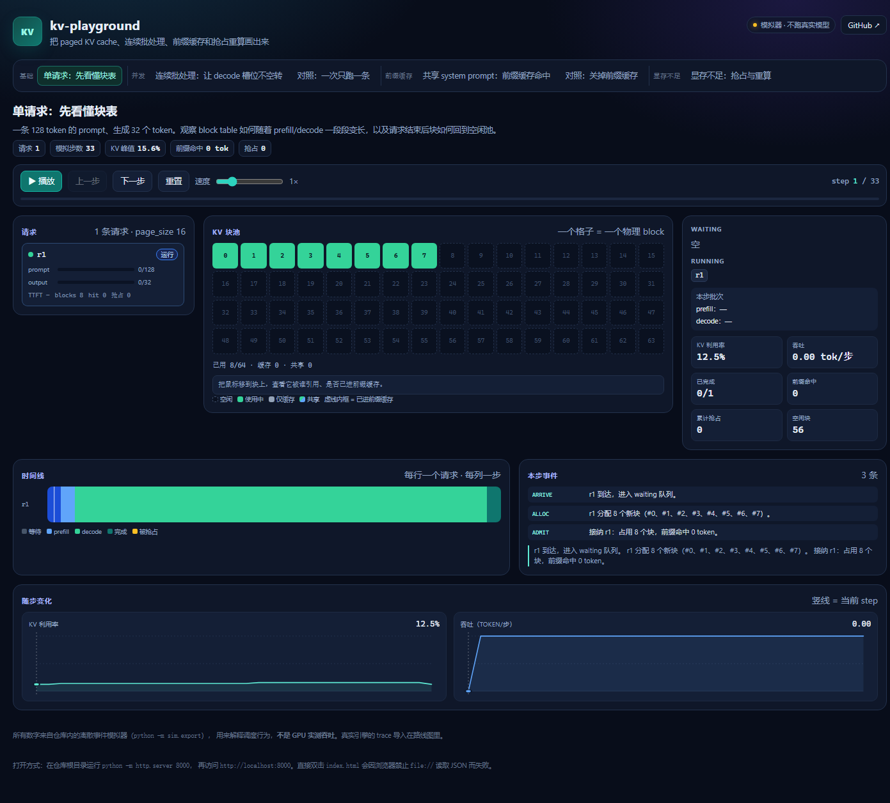
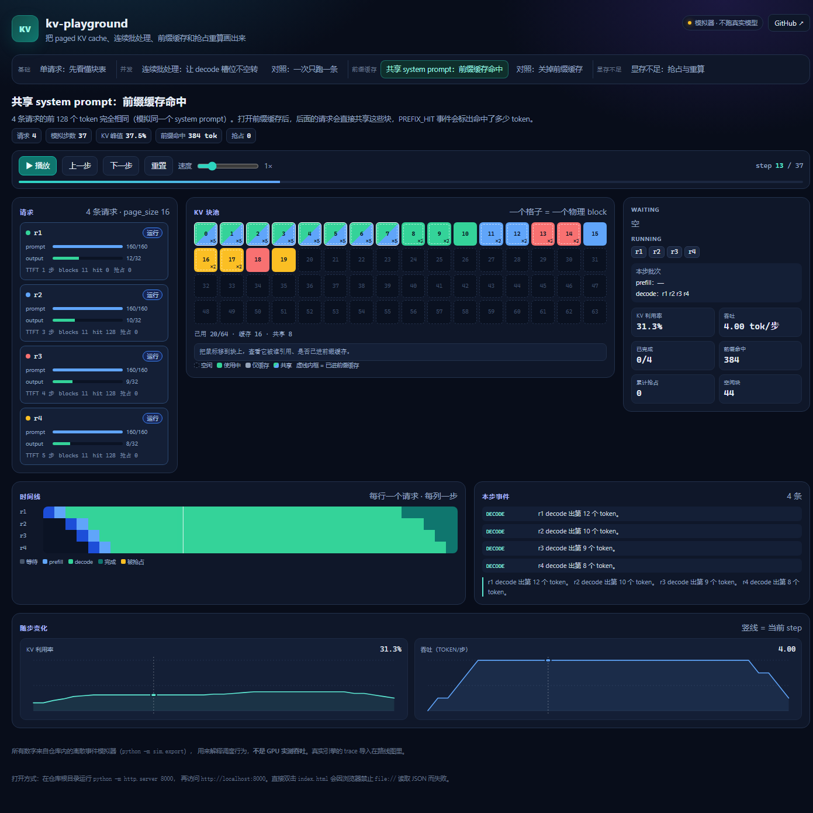

# kv-playground — 把 LLM 推理的 KV cache 与连续批处理画出来

[](https://github.com/XXY-bkb/kv-playground/actions/workflows/tests.yml)


> 一个**零依赖**的教学型可视化：用 Python 标准库写一个确定性的离散事件模拟器，
> 把 paged KV cache、连续批处理、前缀缓存和显存不足时的抢占重算，
> 导出成带版本号的 trace JSON，再由原生 JavaScript 在浏览器里逐步回放。

**当前状态**：模拟器、22 个 Python 单测、7 个前端纯函数测试、6 个场景的 trace 导出和零依赖前端回放都已完成；
下一步是 GitHub Pages 部署与真实引擎 trace 导入。
所有数字都是**模拟步数**，不是真实 GPU 的 wall-clock 性能。

## 先看两张图





## 在线 demo

GitHub Pages 部署后地址：<https://XXY-bkb.github.io/kv-playground/>（纯静态，无需后端）。

本地看：在仓库根目录运行 `python -m http.server 8000`，打开 <http://localhost:8000/>。
不要直接双击 `index.html`：浏览器会以 `file://` 打开，`fetch` 读不到 `data/scenarios/*.json`。

## 它能让你看到什么

| 场景 | 你能看到的现象 |
|---|---|
| `single` | 一条请求从 prefill 到 decode，块表如何一页页增长 |
| `concurrent` | 6 条请求、最多同时跑 3 条：连续批处理如何把等待时间叠起来 |
| `concurrent-static` | 同样的 6 条请求、但一次只跑 1 条：对比“静态批处理”浪费了多少步 |
| `shared-prefix` | 4 条请求共享 128 token 的 system prompt：前缀缓存命中后块被共享 |
| `shared-prefix-no-cache` | 同样的负载关掉前缀缓存：KV 占用和命中次数的差别 |
| `oom` | 故意只给 24 个块：看调度器如何抢占、重算，并保证输出完整 |

## 快速开始

不需要安装任何第三方包（Python 3.10+，只用标准库）。

```bash
# 1. 重新生成 6 个场景的 trace（写入 data/scenarios/）
python -m sim

# 2. 跑测试（Python 22 个 + 前端纯函数 7 个）
python -m unittest discover -s tests -v
node --test --test-isolation=none tests/js/util.test.mjs tests/js/narration.test.mjs

# 3. 起一个静态服务器看前端（无构建步骤，浏览器直接加载 ES module）
python -m http.server 8000
# 打开 http://localhost:8000/
```

前端支持：场景切换、播放/暂停、上一步/下一步、重置、0.5×–3× 速度、
空格键播放/暂停、左右方向键单步、鼠标悬停块查看引用计数与前缀哈希。

## 架构

```text
sim/                      Python 标准库模拟器
  model.py                请求、序列、块的数据结构
  block_manager.py        物理块池：分配 / 共享 / 引用计数 / 释放
  prefix_cache.py         前缀链哈希 + LRU 驱逐
  scheduler.py            running 优先的调度、预算拆分、抢占、缓存驱逐
  simulator.py            按步推进，生成事件与每步快照
  scenarios.py            6 个场景定义
  export.py               导出 trace JSON + index.json
data/scenarios/           生成好的 trace（前端直接 fetch）
index.html                页面骨架（单页，无构建）
css/app.css               深色主题、三栏布局、响应式
js/                       原生 ES module：回放控制、块池、时间线、图表、事件翻译
tests/                    unittest（Python）+ node:test（前端纯函数）
docs/screenshot-*.png     README 用的桌面截图
docs/design.md            设计说明、不变量、已知限制
```

数据流只有一条：`sim` → `trace JSON` → `web`。前端不跑调度逻辑，只负责回放和解释，
所以模拟器的行为可以单独用 Python 测试，前端也可以换任何技术栈。

## Trace 格式（`kv-playground/1`）

```json
{
  "schema": "kv-playground/1",
  "scenario": { "id": "shared-prefix", "title": "共享 system prompt", "...": "..." },
  "config": { "page_size": 16, "num_blocks": 64, "max_num_seqs": 4,
              "max_num_batched_tokens": 512, "prefix_cache": true },
  "requests": [ { "id": "r1", "prompt_len": 160, "output_len": 32,
                  "arrival_step": 0, "shared_prefix_len": 128 } ],
  "steps": [ { "step": 0, "waiting": [], "running": [], "batch": {},
               "blocks": { "used": [], "free": [] },
               "block_tables": {}, "requests": {}, "events": [],
               "metrics": { "kv_util": 0.0, "throughput": 0.0,
                            "prefix_hit_tokens": 0, "preemptions": 0,
                            "finished": 0 } } ],
  "summary": { "total_steps": 37, "total_output_tokens": 128,
               "peak_kv_util": 0.375, "preemptions": 0,
               "prefix_hit_tokens": 384, "finished": 4, "total_requests": 4 }
}
```

字段的完整含义、每个事件的类型、以及“哪些是模拟的、哪些没有建模”，
见 [docs/design.md](docs/design.md)。

## 设计上的几个取舍

- **running 优先**：先给正在跑的请求分配块，最后才接纳新请求。否则新请求可能抢光块，
  让正在 decode 的请求反复被抢占，产生“抖动”。
- **前缀链哈希**：只对单个块哈希会错误命中（前面 token 不同，KV 也不同）；
  这里把“前一块的哈希 + 当前块 token”一起哈希，并额外保存块内 token 做碰撞校验。
- **缓存驱逐优先于抢占**：前缀缓存里的块只是“可能有用”，不是正在计算的状态；
  块不够时先按 LRU 驱逐缓存，再考虑抢占 running 序列。
- **确定性**：空闲池按 id 顺序取、哈希固定、JSON 排序输出；同一场景两次导出的字节完全一致。

## 部署到 GitHub Pages

这是纯静态站点，不需要构建：

1. 把仓库推到 GitHub（public）；
2. Settings → Pages → Build and deployment → Source 选 **Deploy from a branch**，
   Branch 选 `main`、目录选 `/ (root)`；
3. 等 1–2 分钟，访问 `https://<用户名>.github.io/kv-playground/`。

首页、`css/`、`js/`、`data/` 都是相对路径，放在仓库根目录即可。

## 已知限制（不要在简历里夸大）

- 不跑真实模型，没有 GPU 计时；`total_steps` 是模拟步数，不是吞吐。
- 没有建模 swap、TP、chunked prefill 的完整实现（预填充分片只做了预算拆分）。
- 真实引擎的 trace 导入是下一阶段，目前只有模拟器生成的 trace。

## 许可

代码 MIT。第三方内容（如果以后引入）会在 `NOTICE` 中单独标注。
